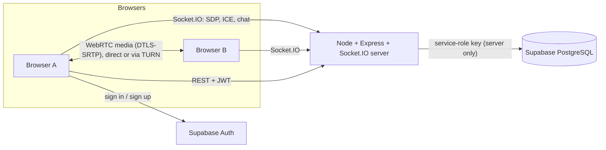
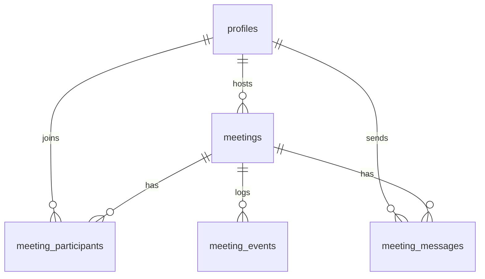
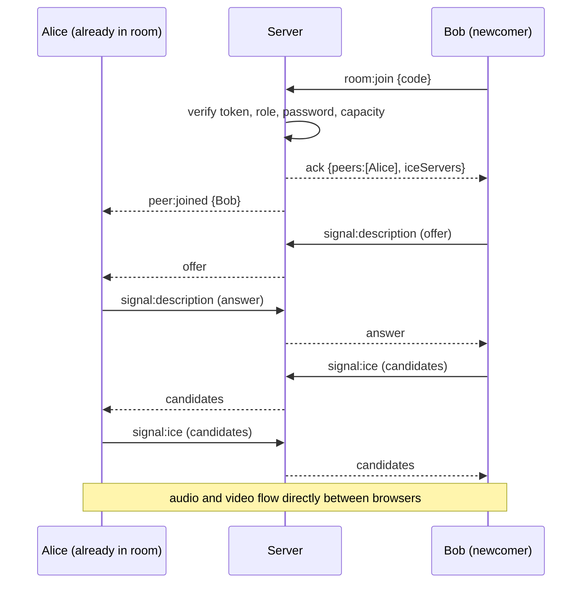

<div align="center">


# MeetSphere

### Video meetings that just work. Free, open source, built on standard web technology.

Real peer-to-peer **WebRTC** video and audio, live chat, screen sharing, a waiting room and host controls, all in the browser with nothing to install.

<br />

[](https://meetsphere-zc01jle8.back4.app/health)
[](#-live-demo)
[](#-license)


[**Live demo**](#-live-demo) · [**Features**](#-features) · [**Architecture**](#-architecture) · [**Quick start**](#-quick-start) · [**Docs**](#-documentation) · [**Developer**](#-developer)

</div>

---

## Table of contents

- [Live demo](#-live-demo)
- [Why MeetSphere](#-why-meetsphere)
- [Features](#-features)
- [Tech stack](#-tech-stack)
- [Architecture](#-architecture)
- [How a call is set up](#-how-a-call-is-set-up)
- [Security](#-security)
- [Project structure](#-project-structure)
- [Quick start](#-quick-start)
- [Environment variables](#-environment-variables)
- [Testing](#-testing)
- [Deployment](#-deployment)
- [Keyboard shortcuts](#-keyboard-shortcuts)
- [Known limitations](#-known-limitations)
- [Roadmap](#-roadmap)
- [Documentation](#-documentation)
- [License](#-license)
- [Developer](#-developer)

---

## 🌐 Live demo

| | Link |
|---|---|
| **Web app (Vercel)** | Open the deployed site from the repository's **Website** link in the About panel |
| **API / signalling server** | https://meetsphere-zc01jle8.back4.app |
| **Health check** | https://meetsphere-zc01jle8.back4.app/health |
| **Source code** | https://github.com/Roni-Seikh/Meetsphere |

> **Try it with two people:** sign in on two different devices or browsers (use a private window for the second one, because two tabs in the same profile share one login and the newer tab replaces the older), create a meeting on one, and join with the invite link on the other.

> **Cold starts:** a hosted backend may take a few seconds to wake after a period of inactivity. If the first request fails, wait a moment and retry.

---

## ✨ Why MeetSphere

MeetSphere is a complete, working video-conferencing platform built from first principles: not a UI mock-up and not a wrapper around a paid video SDK. It implements the hard parts itself:

- the **WebRTC peer connection lifecycle** (offer/answer, trickle ICE, glare handling, cleanup);
- a **Socket.IO signalling server** with server-side room membership and role enforcement;
- **authentication and authorization** with Supabase Auth, bcrypt-protected meeting passwords and row-level security;
- a **polished, accessible interface** with light and dark themes.

It runs on free tiers and is designed to be read, understood and extended.

---

## 🚀 Features

### Meetings
- Create a meeting with a **title**, optional **schedule**, optional **password**, a **2-8 participant cap** and an optional **waiting room**
- Join with a **meeting ID** (`abc-defg-hij`) or a shareable **invite link**; one-click copy
- **Lobby** with live camera preview and mic/camera toggles before you enter
- **Dashboard** with upcoming/live meetings and recent history; a full **history** page with duration, role and status

### In the call
- **Real-time audio and video** directly between browsers (WebRTC)
- **Mute / unmute** and **camera on / off**, with live indicators for every participant
- **Screen sharing**, with the camera restored automatically when you stop (including via the browser's own "Stop sharing" bar)
- **Live chat**: validated, rate-limited, saved to the database, with history shown to new joiners
- **Raise hand** and **emoji reactions** (👍 👏 🎉 😂 😮 🙌)
- **Network-quality bars** on each participant, from live round-trip time and packet loss
- **Meeting timer**, participant count, meeting ID and invite link in the header
- Automatic **reconnection**, duplicate-tab replacement and a grace period so a page refresh doesn't end the meeting

### Host controls
- **Waiting room**: admit or decline guests as they arrive
- **Remove** a participant (they cannot rejoin)
- **End the meeting for everyone**
- Roles are decided by the server from the database, never by the client

### Experience and accessibility
- Responsive layout from phone to desktop, **light and dark themes**
- Keyboard shortcuts, labelled controls, live regions for status changes, visible focus
- Friendly handling of **denied, missing or busy** cameras and microphones (you can still join and watch)
- Clear loading, empty, success and error states, plus 404 and access-denied pages

---

## 🧰 Tech stack

| Layer | Technology |
|---|---|
| **Frontend** | React 18, TypeScript, Vite 6, Tailwind CSS 4, React Router 6, Lucide icons |
| **Real-time media** | Browser WebRTC APIs (`RTCPeerConnection`, `getUserMedia`, `getDisplayMedia`), STUN, optional TURN |
| **Signalling** | Socket.IO 4 |
| **Backend** | Node.js, Express 5, TypeScript, Zod, Helmet, express-rate-limit, Pino, bcryptjs |
| **Database and auth** | Supabase (PostgreSQL, Supabase Auth, Row Level Security) |
| **Testing** | Vitest, React Testing Library, Supertest, Playwright |
| **Hosting** | Vercel (frontend), Back4app (backend), Supabase (database and auth) |

---

## 🏗 Architecture

The **server never carries audio or video.** It only coordinates: verifying who you are, deciding who may be in which room, and relaying the small messages two browsers need to find each other. Media flows directly between browsers (or through a TURN relay when a network blocks direct paths).



| Part | Responsibility |
|---|---|
| **Client** | UI, Supabase sign-in, camera/mic/screen capture, owns every `RTCPeerConnection` |
| **Server** | Verifies tokens, REST API for meetings, authoritative room state, signalling relay, chat persistence, host rules |
| **Supabase** | Users and passwords (Auth) and all persistent data (PostgreSQL) |
| **STUN / TURN** | Helps browsers discover each other; TURN relays media when a direct connection is impossible |

### Data model



Five tables, constraints on every status and length, a partial unique index that guarantees **one open session per user per meeting**, and indexes for history and chat queries. See [`docs/database-schema.md`](docs/database-schema.md).

---

## 🔌 How a call is set up



Race conditions are handled deliberately:

- **Who offers:** the newcomer offers to everyone already present, so normal joins never collide.
- **Offer collisions:** the "perfect negotiation" pattern (polite and impolite peers) resolves simultaneous offers.
- **Early ICE candidates** are queued per peer and applied once the remote description is set.
- **Duplicate connections** are impossible: peer creation is idempotent per user.
- **Duplicate tabs:** the server keeps only the newest socket and ignores late disconnects from stale ones.

Full event reference: [`docs/signalling-protocol.md`](docs/signalling-protocol.md).

---

## 🔐 Security

| Area | What is implemented |
|---|---|
| **Authentication** | Supabase Auth; the server verifies the JWT on every REST call and every socket handshake |
| **Authorization** | Identity and role come only from the verified token and the database. Client-sent roles, user IDs and `from` fields are ignored |
| **Meeting access** | Authentication required, optional bcrypt-hashed password, capacity limit, removed users blocked, ended meetings closed, optional waiting room |
| **Validation** | Zod schemas on every REST body and socket payload, with size limits |
| **Abuse prevention** | API rate limits, token buckets for chat, signalling, reactions and join attempts (password brute-force guard) |
| **Transport and headers** | HTTPS in production, Helmet, CORS allow-list from environment |
| **XSS / CSRF** | React escapes all output (tested); the API uses `Authorization` headers, not cookies |
| **Secrets** | Service-role key and TURN credentials exist only in server environment variables; the browser only ever holds the public anon key |
| **Database** | Row Level Security, explicit grants, constraints, no plaintext passwords |
| **Logging** | Structured logs with redaction; tokens, passwords and chat contents are never logged |
| **Operations** | Central error handler, health endpoint, graceful shutdown |

> **Encryption note:** media is encrypted in transit with DTLS-SRTP, and the interface says so. MeetSphere does **not** claim end-to-end encryption: the signalling server relays the key fingerprints, so it is a trusted party. Details in [`docs/security.md`](docs/security.md).

---

## 📁 Project structure

```text
meetsphere/
├── client/                      # React + Vite frontend
│   ├── src/
│   │   ├── components/          # UI building blocks and call components
│   │   │   └── call/            # VideoTile, ControlBar, ChatPanel, ParticipantsPanel, ...
│   │   ├── context/             # Auth context (Supabase session)
│   │   ├── hooks/               # useMeetingRoom, useLocalMedia, useTheme
│   │   ├── lib/
│   │   │   └── webrtc/          # PeerManager (peer lifecycle) and quality scoring
│   │   └── pages/               # Landing, auth, dashboard, room, history, settings
│   └── e2e/                     # Playwright specs
├── server/                      # Express + Socket.IO backend
│   ├── src/
│   │   ├── config/              # Validated environment
│   │   ├── middleware/          # Auth and error handling
│   │   ├── routes/              # REST API
│   │   ├── services/            # Join and authorization policy
│   │   ├── sockets/             # Signalling and in-memory room registry
│   │   └── store/               # Supabase and in-memory storage implementations
│   └── tests/                   # API, signalling and unit tests
├── database/migrations/         # SQL schema, policies and grants
├── docs/                        # Architecture, security, testing, deployment, ...
└── README.md
```

---

## ⚡ Quick start

**Requirements:** Node.js 20 or newer (tested with 22 and 24), npm, Git, a free [Supabase](https://supabase.com) project, and Chrome or Edge.

```powershell
# 1. Clone
git clone https://github.com/Roni-Seikh/Meetsphere.git
cd Meetsphere

# 2. Install both packages
npm run install:all

# 3. Create environment files, then fill in your Supabase values
Copy-Item server\.env.example server\.env
Copy-Item client\.env.example client\.env

# 4. Run (two terminals)
npm run dev:server     # http://localhost:4000/health
npm run dev:client     # http://localhost:5173
```

**Database:** in the Supabase dashboard open **SQL Editor**, paste [`database/migrations/0001_init.sql`](database/migrations/0001_init.sql) and run it. For quick local testing, disable **Confirm email** under *Authentication → Providers → Email*.

Step-by-step guide with troubleshooting: [`docs/setup-windows.md`](docs/setup-windows.md).

### Useful scripts

| Command | What it does |
|---|---|
| `npm run install:all` | Install server and client dependencies |
| `npm run dev:server` / `npm run dev:client` | Start each in watch mode |
| `npm run typecheck` | Strict TypeScript check of both packages |
| `npm test` | Run all automated tests |
| `npm run build` | Production builds |

---

## 🔧 Environment variables

**`server/.env`** (secrets, server only, never commit):

| Variable | Required | Description |
|---|---|---|
| `SUPABASE_URL` | yes | Your Supabase project URL |
| `SUPABASE_SERVICE_ROLE_KEY` | yes | Secret service-role key. Server only |
| `CLIENT_ORIGIN` | yes | Allowed browser origin(s), comma-separated, no trailing slash |
| `PORT` | no | Defaults to `4000` |
| `NODE_ENV` | no | `development`, `test` or `production` |
| `LOG_LEVEL` | no | Defaults to `info` |
| `TURN_URLS`, `TURN_USERNAME`, `TURN_CREDENTIAL` | no | Optional TURN relay for restrictive networks |

**`client/.env`** (public values only):

| Variable | Description |
|---|---|
| `VITE_API_URL` | URL of the backend |
| `VITE_SUPABASE_URL` | Your Supabase project URL |
| `VITE_SUPABASE_ANON_KEY` | Public anon / publishable key |

The server validates its configuration at start-up and exits with a clear message if anything is missing.

---

## 🧪 Testing

```powershell
npm run typecheck
npm test
npm run build
```

| Suite | Tests | Covers |
|---|---|---|
| **Server** (Vitest, Supertest, real Socket.IO clients) | 57 | Token rejection, validation, host-only actions, passwords, capacity, removal, room isolation, signalling relay, chat rules and rate limits, duplicate tabs, reconnection grace, waiting room, hand raising, reactions |
| **Client** (Vitest, Testing Library) | 31 | Peer lifecycle and glare handling, ICE queueing, quality scoring, chat XSS safety, every call control, host-only UI, waiting list |
| **End-to-end** (Playwright, in `client/e2e`) | specs | Public pages and a real two-user call using Chromium's fake camera and microphone |

Real audio/video quality, screen sharing and cross-network behaviour need real devices. The manual checklist is in [`docs/testing.md`](docs/testing.md).

---

## ☁️ Deployment

| Component | Host | Notes |
|---|---|---|
| Frontend | **Vercel** | Static build of `client/`; SPA rewrites in `client/vercel.json` |
| Backend | **Back4app** | Runs `server/`; health check at `/health` |
| Database and auth | **Supabase** | Free tier |

Set `CLIENT_ORIGIN` on the backend to the exact frontend URL, and `VITE_API_URL` on the frontend to the backend URL. Both must use HTTPS because browsers only allow camera and microphone access on secure origins.

**Operational notes**

- Free-tier backends can sleep when idle and restart at any time. Room state lives in memory, so clients automatically rejoin; meeting data stays in PostgreSQL.
- Free Supabase projects pause after about a week of inactivity and can be restored from the dashboard.
- Relayed (TURN) traffic is metered by providers and can become a cost. The app works without TURN, but some network pairs will not connect.

See [`docs/deployment.md`](docs/deployment.md) for the full guide.

---

## ⌨️ Keyboard shortcuts

| Key | Action |
|---|---|
| `M` | Mute / unmute microphone |
| `V` | Camera on / off |
| `S` | Start / stop screen sharing |
| `C` | Toggle chat |
| `P` | Toggle participants |
| `H` | Raise / lower hand |

Shortcuts are ignored while you are typing in a text field.

---

## ⚠️ Known limitations

- **Mesh topology:** every participant sends one video stream per peer, so bandwidth grows quickly. Keep meetings to **2-4 people** (hard cap 8). An SFU would be the next step for larger rooms.
- **TURN is optional:** without a relay, some networks (symmetric NAT, strict firewalls) cannot connect.
- **Single server instance:** room state is in memory and rate limits are per process. Scaling out would need the Socket.IO Redis adapter and shared state.
- **Not end-to-end encrypted:** see the [security](#-security) note.
- Not yet built: meeting recording, AI transcription and summaries, a calendar-style dashboard.

---

## 🗺 Roadmap

- [ ] Local meeting recording with explicit consent from every participant
- [ ] Optional on-device transcription and summaries with open-source tools
- [ ] Calendar-style dashboard for scheduled meetings
- [ ] SFU-based media for larger meetings
- [ ] Short-lived TURN credentials
- [ ] Continuous integration running the Playwright suite

Ideas and pull requests are welcome.

---

## 📚 Documentation

| Document | Contents |
|---|---|
| [Architecture](docs/architecture.md) | Responsibilities, lifecycle, media management, mesh limits |
| [Database schema](docs/database-schema.md) | Tables, constraints, indexes, row-level security |
| [Signalling protocol](docs/signalling-protocol.md) | Every socket event, sequence diagram, race-condition handling |
| [Security](docs/security.md) | Controls, encryption notes, known gaps |
| [Testing](docs/testing.md) | Automated suites and the manual checklist |
| [Deployment](docs/deployment.md) | Free-tier hosting guide and limits |
| [Windows setup](docs/setup-windows.md) | Step-by-step local setup with troubleshooting |

---

## 📄 License

Released under the **MIT License**. MeetSphere is an original educational and portfolio project and is not affiliated with any video-conferencing vendor.

---

## 👨‍💻 Developer

<div align="center">

### Roni Seikh

*Full-stack developer · designed, built, tested and deployed MeetSphere*

[](https://github.com/Roni-Seikh)
[](https://github.com/Roni-Seikh/Meetsphere)
[](https://meetsphere-zc01jle8.back4.app/health)

</div>

| | |
|---|---|
| **GitHub** | [@Roni-Seikh](https://github.com/Roni-Seikh) |
| **Project** | MeetSphere: real-time video conferencing platform |
| **Skills shown** | WebRTC, real-time systems, TypeScript, React, Node.js, REST and WebSocket APIs, PostgreSQL, authentication and authorization, automated testing, cloud deployment |

If MeetSphere helped or inspired you, please consider giving the repository a ⭐ on GitHub.

<div align="center">

**Built with care using React, WebRTC, Socket.IO and Supabase.**

</div>
