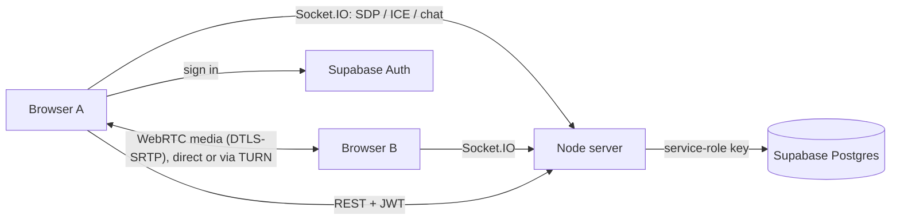

# MeetSphere

A free, open-source video-conferencing web app: real WebRTC audio/video, live chat, screen sharing, host controls, and persistent meeting history. Built as an educational portfolio project (original design; not affiliated with any vendor).

**Stack:** React 18 · TypeScript · Vite · Tailwind 4 · Express 5 · Socket.IO · Supabase (Postgres + Auth) · WebRTC · Vitest · Playwright

## Features
- Register / sign in (Supabase Auth), protected routes, profile, light/dark theme
- Create meetings (title, optional schedule, optional password, 2-8 participant cap), invite link + meeting ID
- Lobby with camera/mic preview, graceful handling of denied / missing / busy devices
- Real peer-to-peer video + audio (mesh), mute, camera toggle, connection status per participant
- Screen sharing with automatic camera restore when the browser's "Stop sharing" is used
- Real-time chat (validated, rate-limited, saved, room-isolated, history on join)
- Host controls: remove participant (cannot rejoin), end meeting for everyone
- **Waiting room** (optional per meeting): guests wait at the door until the host admits or declines them
- **Raise hand** and **emoji reactions** (allow-listed, rate-limited, shown to everyone)
- **Network-quality bars** per participant (from WebRTC round-trip time and packet loss)
- Access-denied screen for removed users; clear states for declined / ended / waiting
- Meeting history with duration, role and status
- Reconnection handling, duplicate-tab replacement, grace period before an empty room ends
- Security: server-verified tokens, server-decided roles, Zod validation, Helmet, CORS allow-list, rate limits, RLS

## Quick start (Windows PowerShell)
Full instructions: **[docs/setup-windows.md](docs/setup-windows.md)**.
```powershell
cd meetsphere
npm run install:all
# create server\.env and client\.env from the .env.example files, then:
npm run dev:server     # terminal 1  -> http://localhost:4000/health
npm run dev:client     # terminal 2  -> http://localhost:5173
```

## Scripts
| Command | What it does |
|---|---|
| `npm run install:all` | install server + client dependencies |
| `npm run typecheck` | strict TypeScript check of both packages |
| `npm test` | server (57) + client (31) automated tests |
| `npm run build` | production builds |

## Documentation
[Architecture](docs/architecture.md) · [Database schema](docs/database-schema.md) · [Signalling protocol](docs/signalling-protocol.md) · [Security](docs/security.md) · [Testing](docs/testing.md) · [Deployment](docs/deployment.md) · [Windows setup](docs/setup-windows.md) · [Interview prep](docs/interview-prep.md) · [Resume entry](docs/resume-entry.md)

## Architecture at a glance

The server **never carries media**; it only relays signalling messages and enforces who may be in which room.

## Known limitations (honest list)
- **Mesh topology:** each participant uploads one stream per peer. Keep meetings to 2-4 people (hard cap 8). An SFU would be the next step.
- **TURN is optional and not bundled.** Without a TURN relay some network pairs (e.g. two symmetric NATs, strict corporate firewalls) cannot connect.
- **Free tiers:** Supabase pauses idle projects (~7 days); a free Render server sleeps after ~15 min idle and restarts lose in-memory room state (clients auto-rejoin). See [deployment](docs/deployment.md).
- **Not end-to-end encrypted.** Media is encrypted in transit (DTLS-SRTP) between peers/relays, but this is not E2EE in the Zoom/Signal sense.
- Not built: meeting recording, AI transcription/summaries, a calendar-style dashboard. (Recording needs a consent protocol for every participant, so it was left out rather than shipped half-done.)
- The real two-person call has **not** been verified by an automated run in the authoring environment (no browser available there). Do the manual check in [docs/testing.md](docs/testing.md).

## License
MIT (add a LICENSE file before publishing).
