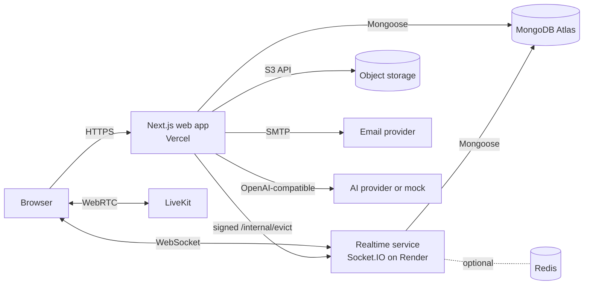

<div align="center">

# 🌐 TeamSphere AI

### Chat · Meetings · Tasks · Decisions · Knowledge — one workspace, with AI that shows its sources

A full-stack team collaboration platform in the spirit of Slack, Microsoft Teams and Google Meet,
built as a serious portfolio project with free and open-source tooling.

[](https://teamsphere-ai.vercel.app/)
[](https://teamsphere-ai.onrender.com/health)
[](https://github.com/Roni-Seikh/teamsphere-ai)


[**Live app**](https://teamsphere-ai.vercel.app/) ·
[**Realtime health check**](https://teamsphere-ai.onrender.com/health) ·
[**Features**](#-features) ·
[**Architecture**](#-architecture) ·
[**Quick start**](#-quick-start) ·
[**Deploy free**](#-deploy-for-free) ·
[**Tests**](#-testing) ·
[**Honest limitations**](#-honest-limitations)

</div>

---

> **Heads-up on the free live demo.** The realtime chat service runs on Render's free plan, which sleeps after about 15 minutes
> of inactivity. If chat looks disconnected, open the [health link](https://teamsphere-ai.onrender.com/health) once, wait about a
> minute for it to wake, then reload the app.

## 📌 Table of contents

1. [Why TeamSphere AI](#-why-teamsphere-ai)
2. [Features](#-features)
3. [Tech stack](#-tech-stack)
4. [Architecture](#-architecture)
5. [Security and privacy design](#-security-and-privacy-design)
6. [Quick start](#-quick-start)
7. [Environment variables](#-environment-variables)
8. [Optional services](#-optional-services)
9. [Deploy for free](#-deploy-for-free)
10. [Testing](#-testing)
11. [Project structure](#-project-structure)
12. [Scripts](#-scripts)
13. [Honest limitations](#-honest-limitations)
14. [Roadmap ideas](#-roadmap-ideas)
15. [About the developer](#-about-the-developer)

## 💡 Why TeamSphere AI

Most "clone" projects stop at a chat box. TeamSphere AI goes after the parts of a real collaboration product that are hard:

- **Permissions that hold up.** Every read and write is re-checked on the server against the database. Someone who isn't in a private channel gets *not found*, not *forbidden*, and search, the AI assistant and the knowledge graph never include what they can't see.
- **Realtime you can trust.** A message is saved before it is acknowledged, retries are idempotent, and removed members are evicted from live rooms.
- **AI that doesn't pretend.** Every AI result is labelled with the provider that produced it. Without a model connected, a rule-based **mock provider** runs and says so. Answers cite numbered sources and say "nothing found" instead of guessing.
- **Honesty about what is tested.** See [Testing](#-testing) and [Honest limitations](#-honest-limitations).

## ✨ Features

### 💬 Messaging
- Public and private channels, direct messages and group chats, with channel details, topics, archive and leave
- Real-time messaging over Socket.IO; persisted before acknowledgement; idempotent retries; REST fallback when the socket is down
- Threads, edit, delete, emoji reactions, typing indicators, presence, unread counts, cursor pagination
- `@mentions` with de-duplicated notifications, pinned messages, link previews (server-side fetch with SSRF protection; can be switched off)
- Secure file attachments (content-checked, access-controlled), plus a searchable file library

### 🎥 Meetings
- Instant and scheduled video meetings on **LiveKit**: waiting room, host controls, screen share, in-meeting chat
- **Smart Meeting Brief** before a meeting
- Transcripts with explicit participant consent, a labelled recap, and suggested tasks the host confirms

### ✅ Work management
- **Kanban task board** with drag-and-drop *and* keyboard or dropdown alternatives, labels, an editor, and comments you can edit
- **Projects** with milestones, progress and a rule-based status update (no AI used, and it says so)
- **Decision Ledger**: searchable decisions with review-due flags, "decided in" and "replaced by" links
- **Calendar** with Month, Week and Day views, meeting and task due dates, and in-app reminders

### 🧠 Intelligence
- **Sphere AI**: summaries, action items, unanswered questions and drafts, on a provider-independent layer (mock, or any OpenAI-compatible endpoint, including local Ollama)
- **"Ask your workspace"**: answers with citations, limited to what you are allowed to read
- **Knowledge Graph**: people, channels, projects, tasks, decisions and meetings linked together, built from permission-filtered data only, with an accessible list view
- **Analytics** (admin only; counts public-channel activity and withholds workload for small teams)
- **Global search** with a Cmd/Ctrl+K palette, filtered by permissions inside the query

### 🔔 Focus, notifications and privacy
- **Focus Manager** holds notifications while you concentrate
- Notification bell, per-type preferences, and email digests (daily or weekly)
- **Privacy Control Center**: data export, message retention policy per workspace, and account deletion

### 🔐 Accounts and access
- Email and password (bcrypt), optional Google sign-in, rate limiting, server-side session revocation
- **Two-step verification** (TOTP authenticator app plus single-use recovery codes)
- Roles: **owner, admin, member, guest**; single-use expiring invitation links, with a pending list and revoke; ownership transfer

### 🎨 Experience
- Light and dark themes, responsive layout, keyboard-accessible controls

## 🧰 Tech stack

| Layer | Choice |
| --- | --- |
| Web app | Next.js 16 (App Router, Turbopack), React 19, TypeScript (strict) |
| UI | Tailwind CSS, Radix UI primitives, lucide icons, cmdk, sonner, dnd-kit |
| Forms and validation | React Hook Form + Zod (validation at every boundary) |
| Data fetching | TanStack Query, Zustand |
| Realtime | Separate Socket.IO service (`server/`), optional Redis adapter |
| Video | LiveKit (client, components and server SDK) |
| Database | MongoDB with Mongoose |
| Auth | next-auth v4 (credentials + optional Google), JWT sessions, RBAC |
| Files | Local disk or any S3-compatible storage (for example Cloudflare R2) |
| Email | Nodemailer over SMTP, with a console fallback in development |
| AI | Provider-independent layer, labelled mock provider by default |
| Tests | Vitest (unit and integration), Playwright (end-to-end) |

## 🏗 Architecture



Key ideas (details in [`docs/ARCHITECTURE.md`](docs/ARCHITECTURE.md)):

- **Two processes, one secret.** The web app and the realtime service share `NEXTAUTH_SECRET` and `MONGODB_URI`. Sockets authenticate with short-lived HMAC tokens.
- **Pure permission rules** in `src/lib/authz/` take plain data and return booleans, so they are unit-testable without a database. Services re-load membership on every call.
- **Persist, then acknowledge.** A message is stored before the sender is told it was sent; a client-generated id makes retries safe.
- **Eviction.** When someone loses access, the web app makes a signed call to the realtime service so they stop receiving live events. It is best effort; inbound writes are blocked immediately either way.
- **No background scheduler.** Reminders are generated lazily when notifications are listed; digests and retention run when a scheduler calls a secret-protected endpoint.

## 🛡 Security and privacy design

- bcrypt password hashing, rate limiting on sensitive routes (Redis-backed when `REDIS_URL` is set), single-use hashed tokens for reset and verification
- Server-side session revocation through `User.sessionVersion`
- Non-members receive 404 rather than 403, and permission filters live inside database queries
- Uploads are content-sniffed (a renamed `.html` posing as a PNG is rejected) and served through an access check
- Link previews refuse private and loopback addresses
- Security headers and a CSP; `proxy.ts` guards `/app/*`
- Cron endpoints disabled unless `CRON_SECRET` is set; constant-time comparison
- Secrets stay on the server; `.env*` files are git-ignored

> No security audit or compliance certification has been performed, and none is claimed. Read
> [`docs/LIMITATIONS.md`](docs/LIMITATIONS.md) before any real-world use.

## 🚀 Quick start

**Prerequisites:** Node.js 20.9+ (developed on 22), npm, and a MongoDB ([Atlas M0 free tier](https://www.mongodb.com/cloud/atlas/register) or local Community Server). Redis is optional.

```powershell
git clone https://github.com/Roni-Seikh/teamsphere-ai.git
cd teamsphere-ai
npm install
Copy-Item .env.example .env.local        # macOS/Linux: cp .env.example .env.local
```

Edit `.env.local`: set `MONGODB_URI` and a long random `NEXTAUTH_SECRET`:

```powershell
[Convert]::ToBase64String((1..32 | % { Get-Random -Max 256 }) -as [byte[]])
```

Start the web app (port 3000) and the realtime service (port 4000) together:

```powershell
npm run dev:all
```

Open <http://localhost:3000>, register, and create a workspace. Use **Invite people** to create a single-use link, open it in a second browser profile, register another user and accept.

**Want demo data?**

```powershell
npm run seed                 # prints a random password
npm run seed -- --reset      # rebuild;  --reset-only removes it
```

Sign in as `owner@demo.teamsphere.test` (or `guest@demo.teamsphere.test`) with the printed password.

## 🔑 Environment variables

Copy `.env.example` to `.env.local` locally; on Vercel and Render add them in each dashboard. Never commit real values.

| Variable | Needed? | Purpose |
| --- | --- | --- |
| `MONGODB_URI` | **Required** (web + realtime) | MongoDB connection string (include a database name) |
| `NEXTAUTH_SECRET` | **Required** (web + realtime, same value) | Session signing and socket tokens |
| `NEXTAUTH_URL`, `APP_URL` | **Required** | Public URL of the web app; on the realtime service `APP_URL` is the CORS origin (no trailing slash) |
| `NEXT_PUBLIC_REALTIME_URL` | **Required** for live chat | Public URL of the realtime service (build-time: redeploy after changing) |
| `REALTIME_PORT` | Realtime | Port the realtime service listens on (default 4000) |
| `REALTIME_INTERNAL_URL` | Recommended in production | Where the web app reaches the realtime service for evictions |
| `STORAGE_DRIVER` (`local` or `s3`), `STORAGE_LOCAL_DIR`, `S3_ENDPOINT`, `S3_REGION`, `S3_BUCKET`, `S3_ACCESS_KEY_ID`, `S3_SECRET_ACCESS_KEY` | Needed for uploads on Vercel | File storage. Vercel's disk is temporary, so use `s3` there |
| `SMTP_HOST`, `SMTP_PORT`, `SMTP_USER`, `SMTP_PASS`, `EMAIL_FROM` | Optional | Email. Without it, messages are logged to the console |
| `LIVEKIT_URL`, `LIVEKIT_API_KEY`, `LIVEKIT_API_SECRET` | Optional | Video meetings |
| `GOOGLE_CLIENT_ID`, `GOOGLE_CLIENT_SECRET` | Optional | Google sign-in (button hidden when unset) |
| `AI_PROVIDER`, `AI_BASE_URL`, `AI_MODEL`, `AI_API_KEY` | Optional | Real AI model (labelled mock when unset) |
| `CRON_SECRET` | Optional (16+ chars) | Enables `/api/internal/digests` and `/api/internal/retention` |
| `REDIS_URL` | Optional | Shared rate limits and the Socket.IO Redis adapter |
| `LINK_PREVIEWS` | Optional | `on` or `off` |
| `TRUSTED_PROXY_HOPS` | Optional | Proxies appending to `x-forwarded-for` (1 on most clouds) |

## 🔌 Optional services

| Service | Without it |
| --- | --- |
| MongoDB | App won't start (clear error) |
| Redis | In-memory rate limiting; single realtime instance |
| Google OAuth | Button not offered |
| LiveKit | Meetings can be scheduled, but nobody can join the call; the page says video isn't configured |
| File storage | Local disk under `./.data/uploads` (the S3 path has not been tested against a real bucket) |
| SMTP | Emails are printed to the server log |
| AI provider | Labelled mock provider (rule-based; cannot translate or rewrite tone) |

<details>
<summary><b>🎥 Enable video meetings (LiveKit)</b></summary>

Create a project on [LiveKit Cloud](https://cloud.livekit.io) (free tier) and set:

```
LIVEKIT_URL=wss://your-project.livekit.cloud
LIVEKIT_API_KEY=...
LIVEKIT_API_SECRET=...
```

Self-hosting also works (`livekit-server --dev` locally, keys `devkey` / `secret`, URL `ws://localhost:7880`), though WebRTC through Docker or
Windows firewalls can need extra setup. Tokens are only issued after the app checks the user may be in the meeting, and secrets never reach the
browser. **The call itself has not been tested against a real LiveKit server**, so use the checklist and report what breaks.
</details>

<details>
<summary><b>🤖 Connect a real AI model (free options available)</b></summary>

Sphere AI speaks the OpenAI chat-completions format. For a local model with [Ollama](https://ollama.com): `ollama pull llama3.2`, then:

```
AI_PROVIDER=openai-compatible
AI_BASE_URL=http://localhost:11434/v1
AI_MODEL=llama3.2
```

Hosted providers work too: set their `AI_BASE_URL`, `AI_MODEL` and `AI_API_KEY`. Keys stay on the server. The OpenAI-compatible path is covered by unit
tests with a faked network but has not been run against a real model.
</details>

<details>
<summary><b>✉️ Email (Brevo free SMTP or Gmail)</b></summary>

**Brevo:** `SMTP_HOST=smtp-relay.brevo.com`, `SMTP_PORT=587`, `SMTP_USER=<login email>`, `SMTP_PASS=<SMTP key>`, and `EMAIL_FROM` set to a verified sender.
**Gmail:** `smtp.gmail.com`, port 587, your address, and an **App Password** (needs 2-step verification), never your normal password.
</details>

<details>
<summary><b>📁 File storage on free hosting (Cloudflare R2)</b></summary>

Create a bucket and an Object Read and Write API token, then set `STORAGE_DRIVER=s3`, `S3_ENDPOINT=https://<account-id>.r2.cloudflarestorage.com`,
`S3_REGION=auto`, `S3_BUCKET`, `S3_ACCESS_KEY_ID` and `S3_SECRET_ACCESS_KEY`. Any S3-compatible service (for example Backblaze B2) works.
</details>

<details>
<summary><b>⏰ Scheduled jobs (digests and retention)</b></summary>

Set `CRON_SECRET` (16+ characters) and have a scheduler (for example the free cron-job.org) send a POST every hour with the header
`Authorization: Bearer <CRON_SECRET>` to `/api/internal/digests` (and `/api/internal/retention` if you use retention).

```powershell
curl.exe -X POST -H "Authorization: Bearer $env:CRON_SECRET" https://teamsphere-ai.vercel.app/api/internal/digests
```
</details>

## ☁️ Deploy for free

This project is deployed as:

| Part | Service | URL |
| --- | --- | --- |
| Web app | Vercel (Hobby) | <https://teamsphere-ai.vercel.app/> |
| Realtime | Render (free web service) | <https://teamsphere-ai.onrender.com/health> |
| Database | MongoDB Atlas M0 | private |
| Video (optional) | LiveKit Cloud free tier | private |
| Files (optional) | Cloudflare R2 free tier | private |

**1. MongoDB Atlas.** Create a free M0 cluster and a database user. Under Network Access add `0.0.0.0/0` (hosts use changing IPs). Copy the connection string and add a database name such as `/teamsphere`.

**2. Realtime on Render.** New, Web Service, connect the repo. Build command `npm ci --include=dev` (the service runs through `tsx`, a dev dependency); start command `npm run start:realtime`; health check path `/health`; plan Free. Environment: `MONGODB_URI`, `NEXTAUTH_SECRET`, `APP_URL`, `NEXTAUTH_URL` (your Vercel URL) and `REALTIME_PORT` if your logs show a port mismatch.

**3. Web app on Vercel.** Import the repo and set `MONGODB_URI`, `NEXTAUTH_SECRET` (same as Render), `NEXTAUTH_URL`, `APP_URL`, `NEXT_PUBLIC_REALTIME_URL` (the Render URL) and `REALTIME_INTERNAL_URL`. Redeploy after any change to a `NEXT_PUBLIC_*` value.

**4. Seed demo data once** from your PC: `$env:MONGODB_URI="<atlas uri>"; npm run seed`.

**Free-tier caveats:** Render sleeps after about 15 minutes idle; Vercel's disk is read-only, so uploads need S3-compatible storage; scheduled jobs need an external scheduler; without SMTP, no emails are delivered.

Every push to `main` redeploys both hosts automatically.

## 🧪 Testing

Three layers. Results from the last full run in the build sandbox:

| Layer | Command | Result |
| --- | --- | --- |
| Type check | `npm run typecheck` | clean |
| Lint | `npm run lint` | clean |
| Unit (Vitest, no database) | `npm test` | **323 / 323 pass** |
| Integration (Vitest + database) | `npm run test:integration` | 189 pass, 5 fail (see below) |
| End to end (Playwright, Chromium) | `npm run test:e2e` | **28 / 28 pass** |
| Production build | `npm run build` | succeeds |

> **Read this honestly.** The integration and e2e runs used **FerretDB, not real MongoDB**, because the build sandbox couldn't run MongoDB. The 5
> integration failures are FerretDB gaps (`$text` search ×3, `$dateToString`, the positional `$` update behind meeting RSVPs) and are expected to
> pass on real MongoDB, but that has not been confirmed. Run both layers against real MongoDB yourself.

```powershell
npm test
$env:TEST_MONGODB_URI="mongodb://127.0.0.1:27017"; npm run test:integration
$env:E2E_MONGODB_URI="mongodb://127.0.0.1:27017/teamsphere_e2e"; npx playwright install chromium; npm run test:e2e
```

Without `TEST_MONGODB_URI`, integration tests use an in-memory MongoDB (downloaded on first run). Some features need real MongoDB; see `docs/LIMITATIONS.md`.

<details>
<summary><b>📋 Manual verification checklist (27 scenarios)</b></summary>

1. Register, land on onboarding, create a workspace, arrive in `#general`.
2. Send a message; reload; it is still there.
3. Open the channel in two tabs: messages, typing indicator and reactions appear live in both.
4. Stop the realtime service while the tab is open: the banner appears; send a message (REST fallback);
   restart the service: the tab recovers and shows messages sent meanwhile.
5. Create a channel from the sidebar; confirm the unread badge appears for a channel with new messages.
6. Invite a second user, accept in another profile, and confirm both see each other in a channel with live updates.
7. Create tasks, assign one to the second user, drag cards between columns, reload, and confirm order persists.
8. Record a decision with a review date in the past: it should show "Review due". Search for a word in its rationale.
9. Attach a PNG and a PDF in a channel: the image shows inline, the PDF downloads. Try renaming an .html file to .png and
   attaching it: it must be rejected. Open the file URL in a second account that is not in a private channel: it must 404.
10. With LiveKit configured: start an instant meeting in one browser, open its link in a second profile as another workspace
    member, and confirm the video/audio connect. Schedule a meeting without inviting the second user and confirm they land in the
    waiting room and the host can admit or deny them. Remove them from the host panel and confirm they cannot rejoin.
11. Open Sphere AI, run "Extract action items" on a channel containing "I'll send the notes by Friday": the owner and deadline should be
   filled in, and a line with no deadline should say "not stated". The result must show the "Mock provider" badge unless you configured a model.
12. Press Ctrl/Cmd+K, type a word from a message in a private channel while signed in as a non-member: it must not appear. As a member
   it should. Mention a user, then check their bell: unread count, click to open, "Mark all read".
13. In Sphere AI, ask "What did we decide about <a word from an earlier message>?": the answer lists numbered sources you can click, and
   nothing from channels you aren't in. Ask about something never mentioned: it must say it found nothing instead of guessing.
14. Open Calendar: a scheduled meeting and a task with a due date appear on the right day; click a day to filter the agenda.
15. Click "Forgot password?", enter your email: without SMTP the dev server console prints the reset link. Open it, set a new
   password, and confirm the old password no longer works and the link can't be used a second time.
16. Open Projects, create one, add a milestone, then create a task on the Tasks page and choose that project. The project's progress bar
   should read 0 of 1 done; move the task to Done and it should read 100%. Comment on the task as one user and check the other user's bell.
   Generate the status update and confirm it says no AI was used. Open the project URL as someone outside the workspace: "not found".
17. Attach a PNG in a channel and send it. Open Files: it is listed with your name and the channel. Search for part of its name, filter
   by Images, then delete it. As someone outside a private channel, files uploaded there must not appear in Files.
18. As owner/admin, hover a message and click Pin: a "Pinned" badge appears and it is listed under Pins in the channel header. As a plain
   member the Pin button must not appear. Unpin from the panel. In a direct message, either person can pin.
19. Post a message containing a public link such as https://example.com: a text card with the page title appears under it (needs outbound
   internet). Post `http://169.254.169.254/` or `http://localhost:3000`: the message posts normally and no card appears. Set
   `LINK_PREVIEWS=off` and restart: no cards, and the server makes no outbound requests.
20. Run `npm run seed`, sign in as `owner@demo.teamsphere.test` with the printed password. Open Projects, Tasks, Decisions, Calendar and
   Pins in #engineering. Sign in as `guest@demo.teamsphere.test`: only #general is visible. `npm run seed -- --reset-only` removes it all.
21. In a channel, click Details: change the topic, add a person, remove them, archive then unarchive. In #general there is no leave/archive
   and the name is locked. Remove someone while they have the channel open in another browser: they stop receiving new messages without refreshing.
22. Open a group chat, then Details: rename it, add a person, leave. Reply in a thread, react to your reply, edit it, delete it.
23. Calendar: switch Month / Week / Day and step forward and back. Create a meeting starting in ~10 minutes: its reminder shows in the bell.
24. Settings → Notifications: turn off "Direct messages", have someone DM you (no bell entry). Set the digest to Daily and press "Send me one now" (needs a verified email; without SMTP it prints to the server console).
25. Settings → Two-step verification: set up with an authenticator app (or compute a code from the shown key), save the recovery codes, sign out, sign in: a code is asked for. Members page as owner: "Make owner" on another member; set Message retention. Settings → Delete account (typed DELETE + password).
26. Meetings → Schedule a meeting, open it: "Ask participants for consent", then paste a transcript, write a recap, suggest tasks and create the ones you keep. (Instant meetings are refused: no waiting room.)
27. Knowledge graph (sidebar): click yourself to see what you're linked to, untick Channels, switch to List. Sign in as the demo guest after `npm run seed`: no projects or decisions appear.

</details>

## 🗂 Project structure

```
teamsphere-ai/
├─ src/
│  ├─ app/            Next.js routes: (auth), app/* pages, api/* route handlers, invite
│  ├─ components/     UI by area: chat, tasks, calendar, meetings, decisions, knowledge, settings, shell
│  └─ lib/
│     ├─ authz/       pure permission rules (unit-tested without a DB)
│     ├─ services/    business logic; re-checks access on every call
│     ├─ db/models/   Mongoose models
│     ├─ security/    TOTP, tokens, rate limiting, cron guard
│     └─ ...          ai, calendar, knowledge, meetings, notifications, reminders, storage
├─ server/            Socket.IO realtime service (+ optional Redis adapter)
├─ scripts/seed.ts    demo workspace generator
├─ tests/             unit, integration, e2e
└─ docs/              ARCHITECTURE.md, LIMITATIONS.md
```

## 🧾 Scripts

| Command | Purpose |
| --- | --- |
| `npm run dev:all` | Next.js (3000) and realtime service (4000) together |
| `npm run dev` / `npm run dev:realtime` | Run each separately |
| `npm run build` / `npm start` | Production build and start of the web app |
| `npm run start:realtime` | Start the realtime service |
| `npm run typecheck` | Strict TypeScript check |
| `npm run lint` | ESLint |
| `npm test` | Unit tests |
| `npm run test:integration` | Database-backed tests |
| `npm run test:e2e` | Playwright browser tests (builds and starts the app itself) |
| `npm run seed` | Demo workspace with five people, channels, project, tasks, decisions and meetings |

## ⚠️ Honest limitations

Full list in [`docs/LIMITATIONS.md`](docs/LIMITATIONS.md). The important ones:

- **Not tested against real services:** LiveKit calls, SMTP delivery, a real AI model, an S3 bucket, and the Redis socket adapter.
- **Not run on real MongoDB:** integration and e2e tests ran on FerretDB (see [Testing](#-testing)).
- **No security audit or compliance certification** has been done.
- **Realtime scaling:** designed for one instance; with `REDIS_URL` the adapter is written but untested.
- **Eviction is best effort** if the realtime service is unreachable at that moment.
- **JWT sessions** can't be revoked individually; revocation works through `sessionVersion`, checked on server-side loads, API calls and socket connects.
- **CSP** allows `'unsafe-inline'` for scripts and styles; a nonce-based policy is future work.
- **Mock AI** is rule-based and clearly labelled. It cannot translate or rewrite tone.

## 🔭 Roadmap ideas

- Run and fix the integration suite on real MongoDB; add CI (GitHub Actions)
- Verify LiveKit, S3 and Redis paths end to end and load-test the realtime service
- Nonce-based CSP, a security review, and push notifications
- Mobile-friendly PWA polish and more accessibility testing with screen readers

## 👨‍💻 About the developer

<div align="center">

**Roni Seikh**

[](https://github.com/Roni-Seikh)
[](https://www.linkedin.com/in/roniseikh/)

Built as a full-stack portfolio project. Feedback, issues and stars are welcome. If you find a bug, please
[open an issue](https://github.com/Roni-Seikh/teamsphere-ai/issues).

⭐ If this project helped or impressed you, consider giving the repository a star.

</div>
