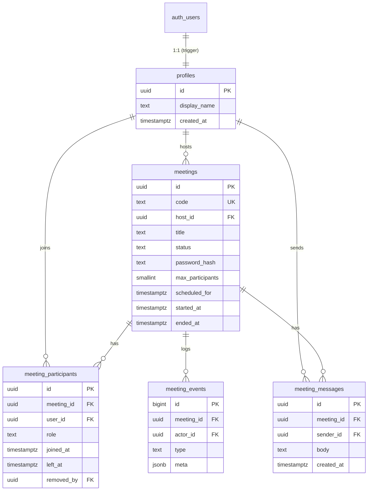

# Database schema

Source of truth: `database/migrations/0001_init.sql` (PostgreSQL on Supabase).

## Key constraints
- `meetings.code` unique + regex `^[a-z]{3}-[a-z]{4}-[a-z]{3}$`; `status ∈ scheduled|live|ended`; `max_participants 2..8`.
- `meeting_participants`: **partial unique index** `(meeting_id,user_id) WHERE left_at IS NULL` guarantees at most one open session per user per meeting.
- `meeting_messages.body` length 1..2000. FKs cascade on meeting delete.
- Indexes: `meetings(host_id, created_at desc)`, `meetings(status) WHERE status<>'ended'`, `mp(meeting_id, joined_at)`, `mp(user_id, joined_at desc)`, `mm(meeting_id, created_at)`, `me(meeting_id, created_at)`.

## Authorization model
- The Node server uses the **service-role key** (bypasses RLS) and performs authorization itself (host check, password, removed-user check, membership).
- RLS is enabled on every table as defence in depth for direct Data-API access with the public anon key: authenticated users may only `SELECT` meetings/participants/messages/events for meetings they host or took part in (`is_meeting_member()`); they can `UPDATE` only their own profile; **no INSERT/UPDATE/DELETE policies** on meeting tables, and `anon` has no grants.
- Explicit `GRANT`s are included because Supabase now requires them for Data-API exposure.
- Passwords: Supabase Auth stores user passwords (hashed). Meeting passwords are stored as bcrypt hashes only.

## Applying
Supabase dashboard → SQL Editor → paste file → Run. (Or `supabase db push` with the CLI.) To reset in development: drop the tables and re-run.
