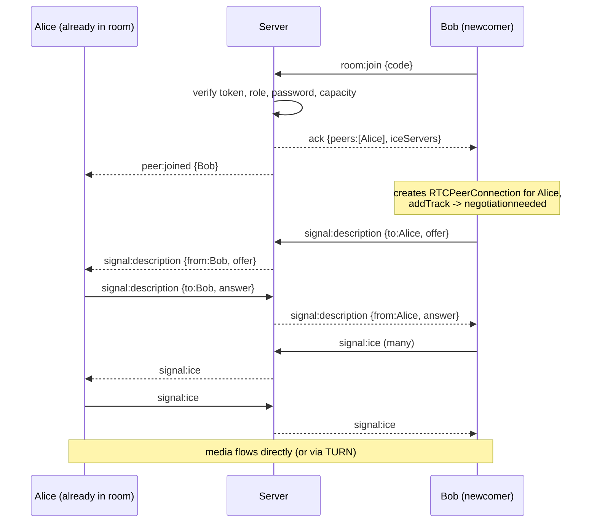

# Signalling protocol (Socket.IO)

Signalling = coordination messages. Audio/video never touch the server.

## Connection
`io(API_URL, { auth: cb => cb({ token: <Supabase access token> }) })`. The server verifies the token in a middleware; invalid → `connect_error: unauthorized`. The token callback runs on every reconnect so refreshed tokens are used.

## Client → server
| Event | Payload | Notes |
|---|---|---|
| `room:join` (ack) | `{ code, password?, media? }` | Ack: `{ ok:true, self, peers, iceServers, messages, meeting }` or `{ ok:false, code, error }`. Rate-limited (5 burst) |
| `room:leave` | – | |
| `signal:description` | `{ to, data:{type,sdp} }` | offer/answer relay |
| `signal:ice` | `{ to, data:{candidate,sdpMid,sdpMLineIndex} }` | |
| `chat:send` (ack) | `{ body }` | 1-2000 chars, token bucket 5 burst / 1 per s |
| `media:state` | `{ audio, video, screen }` | indicators only |
| `host:remove` (ack) | `{ userId }` | host only |
| `host:end` (ack) | – | host only |
| `host:admit` / `host:deny` (ack) | `{ userId }` | host only; waiting-room decisions |
| `hand:set` | `{ raised }` | broadcast as `hand:state` |
| `reaction:send` | `{ emoji }` | emoji must be in the server allow-list; 4 burst, 1/s |

## Server → client
`waiting:list [{userId,name}]` (hosts only), `waiting:admitted`, `waiting:denied`, `hand:state {userId,raised}`, `reaction {userId,name,emoji}`, `peer:joined {peer}`, `peer:left {userId}`, `signal:description {from,data}`, `signal:ice {from,data}`, `chat:message`, `media:state`, `room:ended`, `room:removed`, `room:replaced`.

`from` is always set by the server from the authenticated socket; a client-supplied `from` is ignored. Relay only happens if sender and target are in the same room.

## Join / offer sequence

## Race-condition handling
- **Who offers:** the newcomer offers to everyone already present, so normal joins never collide.
- **Glare** (both offer anyway, e.g. renegotiation for screen share): "perfect negotiation". Polite peer = smaller userId; impolite peer ignores the colliding offer; polite peer accepts it (implicit rollback).
- **Early ICE:** candidates arriving before `setRemoteDescription` are queued per peer and flushed after.
- **Duplicate connections:** `PeerManager.ensurePeer` is idempotent per userId.
- **Same user, two tabs:** server keeps only the newest socket; the old one gets `room:replaced`. A late disconnect from the old socket cannot remove the new session (`RoomRegistry.leave` checks socket id).
- **Refresh / drop:** socket disconnect → `peer:left`; on reconnect the client re-joins and rebuilds all peer connections. An empty room waits 2 min before the meeting is marked ended.
- **Connection failure:** `restartIce()` on `failed`; UI shows per-tile state.

## Waiting room
When `meetings.access_mode = 'waiting_room'` a non-host `room:join` (after the password check) is answered with `{ ok:true, waiting:true }` and the socket is put on a waiting list (not in the media room, so it cannot chat or signal). Hosts receive `waiting:list`. `host:admit` marks the user admitted and sends `waiting:admitted`; the client then repeats `room:join`, which now succeeds. `host:deny` sends `waiting:denied`. Waiting guests are told `room:ended` if the host ends the meeting or the room empties. Admissions are kept in memory for the life of the room so a reconnect does not send an admitted guest back to the lobby.
